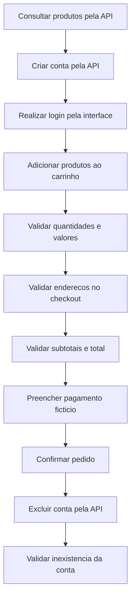
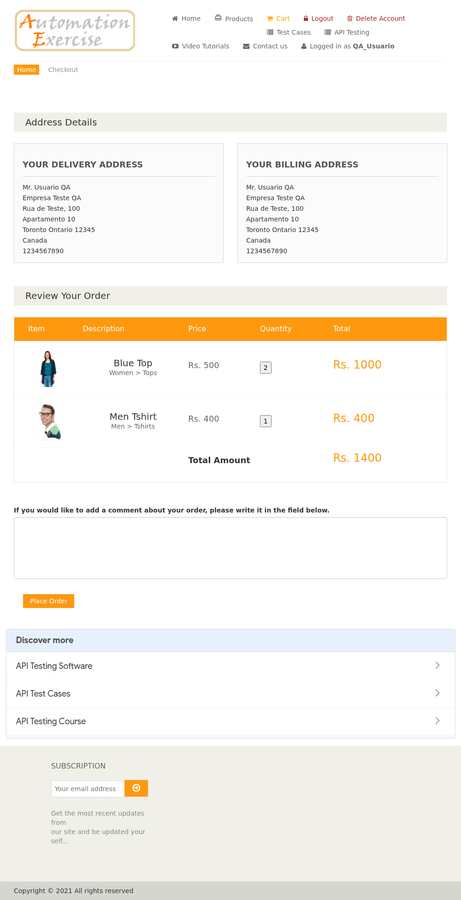
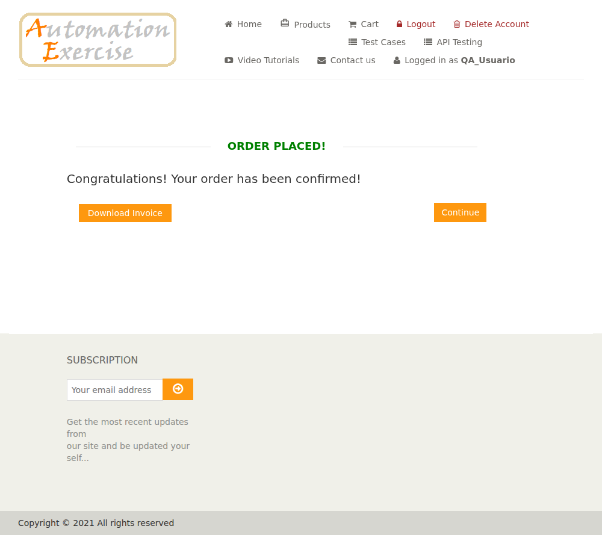
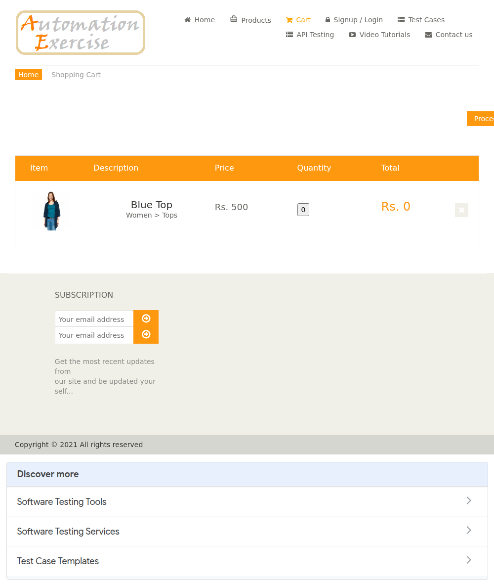
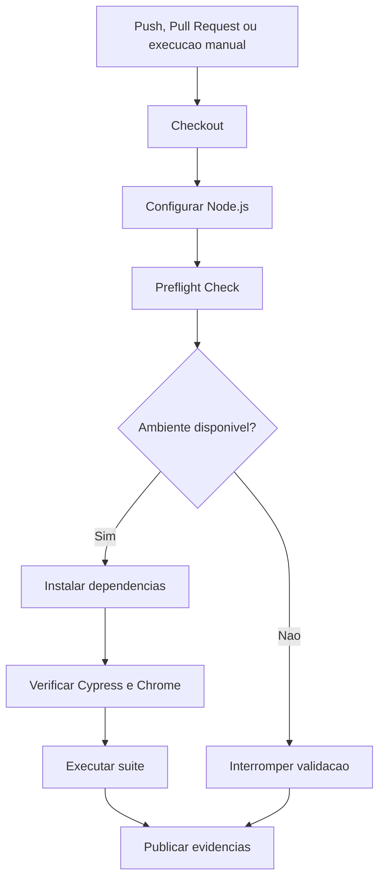

# desafio-qa-cpb
Desafio prático de QA — testes manuais, API e automação Cypress para loja virtual.

# Desafio Prático de QA — CPB

> Avaliação de qualidade de um módulo de loja virtual,
> com planejamento orientado a riscos, automação de testes,
> integração contínua e diagnóstico técnico baseado em evidências.

**Autor:** Gustavo Andrade
**Projeto:** Desafio Prático — Analista de QA
**Organização:** Comitê Paralímpico Brasileiro (CPB)
**Sistema avaliado:** Automation Exercise

---

## 1. Apresentação

Este projeto foi desenvolvido como solução para o desafio
prático de Analista de QA do Comitê Paralímpico Brasileiro.

O objetivo é avaliar a confiabilidade de um módulo de
loja virtual antes de sua aceitação, identificando riscos,
validando comportamentos e apresentando recomendações
fundamentadas em evidências.

A solução contempla:

- Planejamento de testes orientado a riscos.
- Levantamento de dúvidas de negócio.
- Definição de premissas e critérios de aceite.
- Técnicas de elaboração de cenários.
- Automação de testes de interface e API.
- Integração entre interface e API.
- Compra de ponta a ponta.
- Page Object Model.
- Data-Driven Testing.
- Geração dinâmica de dados.
- Limpeza de contas criadas.
- Reprodução controlada de defeito conhecido.
- Integração contínua com GitHub Actions.
- Diagnóstico de qualidade baseado em evidências.
- Documentação das decisões técnicas e do uso de IA.

A proposta não se limita à aprovação dos testes,
mas busca fornecer informações para uma decisão
consciente sobre a qualidade da entrega.

---

## 2. Resultado executivo

### Regressão completa

| Indicador | Resultado |
|---|---:|
| Cenários de teste levantados | 42 |
| Cenários cobertos pela automação | 25 |
| Cenários complementares propostos | 17 |
| Cobertura dos cenários levantados | 59,5% |
| Testes automatizados | 21 |
| Arquivos de teste | 8 |
| Page Objects | 6 |
| Testes convencionais aprovados | 20 |
| Expected Failure reproduzido | 1 |
| Falhas inesperadas na regressão final | 0 |
| Testes ignorados | 0 |
| Achados documentados | 5 |
| Riscos mapeados | 12 |
| Dúvidas de negócio | 17 |
| Arquivos no diretório de evidências | 20 |
| Duração da última regressão | 1m 11s |

**Resultado do Cypress: 21/21 testes contabilizados
como aprovados.**

A execução foi realizada no GitHub Codespaces,
utilizando Cypress 16.4.0 e Electron 150 em modo headless.

Um dos testes aprovados representa a reprodução
controlada de um defeito conhecido.

Portanto, o resultado não significa ausência
de defeitos na aplicação.

O percentual de cobertura refere-se aos cenários
levantados neste desafio, e não à cobertura de código
ou à cobertura integral do sistema.

### Evidências da última execução

A regressão pós-refatoração validou os 21 testes na nova estrutura de diretórios.

A execução anterior permanece disponível como [evidência histórica](evidencias/REGRESSAO-FINAL/RESULTADO.md).

- [Resultado consolidado](evidencias/REGRESSAO-POS-REFATORACAO/RESULTADO.md)
- [Log original do Cypress](evidencias/REGRESSAO-POS-REFATORACAO/resultado-cypress.txt)
- [Checkout validado](evidencias/REGRESSAO-POS-REFATORACAO/E2E-01-checkout-validado.png)
- [Pedido confirmado](evidencias/REGRESSAO-POS-REFATORACAO/E2E-02-pedido-confirmado.png)
- [Expected Failure](evidencias/REGRESSAO-POS-REFATORACAO/BUG-001-expected-failure.png)

---

## 3. Escopo

A avaliação foi organizada nas quatro frentes
solicitadas pelo desafio.

| Frente | Cobertura principal |
|---|---|
| Carrinho de visitante | Inclusão, quantidade, subtotais e remoção de produtos |
| Catálogo e busca | Listagem, pesquisa e consistência entre interface e API |
| API de conta | Criação, consulta, autenticação, atualização e exclusão |
| Compra E2E | Criação de conta pela API, login pela interface, compra e confirmação |

Também foram implementados cenários negativos de API
e verificações básicas de disponibilidade.

A aplicação avaliada é pública, compartilhada
e mantida por terceiros.

Não foram realizados testes invasivos,
testes de carga ou pagamentos reais.

### Endereços de referência

- Aplicação: https://www.automationexercise.com/
- Documentação de APIs: https://automationexercise.com/api_list
- Casos de teste de referência: https://automationexercise.com/test_cases

Os comportamentos esperados foram definidos
considerando as premissas documentadas,
e não apenas a reprodução dos casos publicados pelo site.

---

## 4. Documentação do projeto

| Documento | Conteúdo |
|---|---|
| [PLANEJAMENTO.md](PLANEJAMENTO.md) | Estratégia, riscos, premissas, dúvidas de negócio e critérios de teste |
| [CENARIOS.md](CENARIOS.md) | Cenários, técnicas de teste e matriz de rastreabilidade |
| [ACHADOS.md](ACHADOS.md) | Bugs, inconsistências, riscos, evidências e parecer de qualidade |
| [DECISOES.md](DECISOES.md) | Decisões técnicas, isolamento, reaproveitamento e estratégia de CI |
| [USO-IA.md](USO-IA.md) | Utilização de IA, erros identificados e validação humana |
| [RESULTADO.md](evidencias/REGRESSAO-POS-REFATORACAO/RESULTADO.md) | Resultado consolidado da regressão final |

### Ordem de leitura recomendada

1. README.md
2. PLANEJAMENTO.md
3. CENARIOS.md
4. ACHADOS.md
5. DECISOES.md
6. USO-IA.md
7. RESULTADO.md

---

## 5. Tecnologias utilizadas

| Tecnologia | Finalidade |
|---|---|
| Cypress 16.4.0 | Automação de testes de interface e API |
| JavaScript | Implementação dos testes e componentes |
| Node.js 24 | Ambiente de execução |
| npm | Gerenciamento de dependências |
| Git | Controle de versão |
| GitHub | Hospedagem do repositório |
| GitHub Codespaces | Desenvolvimento e execução em nuvem |
| GitHub Actions | Integração contínua |
| Markdown | Documentação técnica |

### Padrões e técnicas

- Page Object Model.
- Data-Driven Testing.
- Factory de dados.
- Camada reutilizável de API.
- Testes independentes.
- Partição de equivalência.
- Análise de valor limite.
- Tabela de decisão.
- Transição de estado.
- Testes exploratórios.
- Testes de integração.
- Testes de ponta a ponta.
- Testes orientados a riscos.

---

## 6. Arquitetura do projeto

    desafio-qa-cpb/
    |
    |-- .github/
    |   `-- workflows/
    |       `-- qa-pipeline.yml
    |
    |-- cypress/
    |   |-- api/
    |   |   `-- ContaApi.js
    |   |
    |   |-- e2e/
    |   |   |-- smoke/
    |   |   |   |-- acesso-loja.cy.js
    |   |   |   `-- catalogo-api.cy.js
    |   |   `-- regression/
    |   |       |-- api-negativos.cy.js
    |   |       |-- carrinho-known-bugs.cy.js
    |   |       |-- carrinho.cy.js
    |   |       |-- catalogo-ui-api.cy.js
    |   |       |-- compra-e2e.cy.js
    |   |       `-- conta-api.cy.js
    |   |
    |   |-- factories/
    |   |   `-- usuarioFactory.js
    |   |
    |   |-- pages/
    |   |   |-- CarrinhoPage.js
    |   |   |-- CheckoutPage.js
    |   |   |-- DetalhesProdutoPage.js
    |   |   |-- LoginPage.js
    |   |   |-- PagamentoPage.js
    |   |   `-- ProdutosPage.js
    |   |
    |   `-- utils/
    |       `-- moeda.js
    |
    |-- evidencias/
    |   |-- BUG-001/
    |   |-- ACHADO-002/
    |   |-- ACHADO-004/
    |   |-- ACHADO-005/
    |   |-- E2E-001/
    |   |-- REGRESSAO-FINAL/
    |   `-- REGRESSAO-POS-REFATORACAO/
    |
    |-- scripts/
    |   `-- preflight.js
    |
    |-- .gitignore
    |-- cypress.config.js
    |-- package.json
    |-- package-lock.json
    |-- PLANEJAMENTO.md
    |-- CENARIOS.md
    |-- ACHADOS.md
    |-- DECISOES.md
    |-- USO-IA.md
    `-- README.md

### Responsabilidades das camadas

| Camada | Responsabilidade |
|---|---|
| e2e | Cenários e asserções dos testes |
| pages | Seletores e operações de interface |
| api | Operações reutilizáveis de API |
| factories | Geração de dados fictícios |
| utils | Funções auxiliares |
| scripts | Diagnóstico de disponibilidade |
| evidencias | Resultados e comprovações |
| workflows | Integração contínua |

A arquitetura separa as responsabilidades para facilitar
manutenção, legibilidade e reaproveitamento.

---

## 7. Como executar o projeto do zero

### 7.1 Pré-requisitos

- Git.
- Node.js 24.
- npm.
- Acesso à internet.
- Acesso ao repositório.
- Dependências de sistema necessárias ao Cypress.

Ambiente utilizado na execução final:

| Componente | Versão |
|---|---|
| Node.js | 24.22.2 |
| npm | 11.19.1 |
| Cypress | 16.4.0 |
| Electron | 150 |

### 7.2 Clonar o repositório

    git clone https://github.com/gus20comp/desafio-qa-cpb.git

    cd desafio-qa-cpb

Caso o repositório esteja privado, será necessário
possuir autorização de acesso.

### 7.3 Verificar o ambiente

    node --version
    npm --version
    git --version

### 7.4 Instalar as dependências

    npm ci

O arquivo package-lock.json permite reproduzir
as versões das dependências do projeto.

### 7.5 Verificar a instalação do Cypress

    npx cypress verify

    npx cypress info

Em distribuições Linux, poderá ser necessário
instalar dependências adicionais do sistema.

Referência oficial:

https://docs.cypress.io/app/get-started/install-cypress

### 7.6 Validar a disponibilidade da aplicação

Antes de executar os testes:

    node scripts/preflight.js

O diagnóstico verifica a página inicial
e o endpoint de listagem de produtos.

Caso o diagnóstico apresente falha,
recomenda-se investigar a disponibilidade
antes de executar a regressão.

### 7.7 Executar todos os testes

    npm run test:regression

Comando alternativo:

    npm test

### 7.8 Executar em modo interativo

Em um ambiente com interface gráfica disponível:

    npx cypress open

### 7.9 Executar utilizando Chrome

Caso o navegador esteja instalado:

    npm run test:regression -- --browser chrome

O Electron foi utilizado na execução final.

A advertência de descontinuação desse navegador
como opção de teste do Cypress foi registrada.

O Chrome é a alternativa configurada no pipeline.

---

## 8. Execução pelo GitHub Codespaces

O projeto também pode ser executado diretamente
em um ambiente de desenvolvimento em nuvem.

1. Acessar o repositório no GitHub.
2. Clicar em Code.
3. Selecionar a aba Codespaces.
4. Criar um Codespace.
5. Abrir o terminal.
6. Verificar as versões do Node.js e npm.
7. Instalar as dependências.
8. Verificar a instalação do Cypress.
9. Executar o Preflight.
10. Executar a suíte desejada.

Comandos principais:

    npm ci

    npx cypress verify

    node scripts/preflight.js

    npm run test:regression

Caso o Cypress informe dependências de sistema
ausentes em um Codespace baseado em Ubuntu,
instale as bibliotecas necessárias.

Exemplo:

    sudo apt-get update

    sudo apt-get install -y xvfb libgtk-3-0t64 \
      libgbm1 libnotify4 libnss3 libxss1 \
      libasound2t64 libxtst6 libatk1.0-0t64 \
      libatk-bridge2.0-0t64

Os nomes dos pacotes podem variar conforme
a distribuição e a versão do Linux.

Depois, execute novamente:

    npx cypress verify

Caso o binário do Cypress não tenha sido instalado:

    npx cypress install

A execução headless não exige a abertura
de uma interface gráfica.

O GitHub Codespaces foi utilizado devido às
restrições de instalação no equipamento local.

---

## 9. Suítes de teste

| Suíte | Comando | Testes |
|---|---|---:|
| Smoke | npm run test:smoke | 3 |
| API | npm run test:api | 10 |
| E2E/UI | npm run test:e2e | 11 |
| Regression | npm run test:regression | 21 |

O Smoke é um subconjunto da regressão.

As suítes de API e E2E/UI representam grupos
complementares da cobertura automatizada.

### Smoke Testing

    npm run test:smoke

Valida rapidamente:

- Acesso à aplicação.
- Listagem de produtos.
- Pesquisa pela API.

### API Testing

    npm run test:api

Valida:

- Estrutura das respostas.
- Status HTTP.
- Códigos de negócio.
- Mensagens de retorno.
- Métodos não suportados.
- Parâmetros obrigatórios.
- Credenciais inexistentes.
- Ciclo de vida da conta.

### E2E/UI Testing

    npm run test:e2e

Valida:

- Acesso à loja.
- Carrinho de visitante.
- Quantidades e subtotais.
- Inclusão e remoção de produtos.
- Consistência entre interface e API.
- Reprodução do defeito conhecido.
- Compra completa.

### Regression Testing

    npm run test:regression

Executa os oito arquivos de teste
que compõem a cobertura automatizada.

### Executar um arquivo específico

Exemplo:

    npx cypress run --spec "cypress/e2e/regression/carrinho.cy.js"

---

## 10. Inventário da automação

| Arquivo | Testes | Objetivo |
|---|---:|---|
| acesso-loja.cy.js | 1 | Disponibilidade funcional da página inicial |
| api-negativos.cy.js | 7 | Validação de métodos, parâmetros e erros |
| carrinho-known-bugs.cy.js | 1 | Reprodução controlada do BUG-001 |
| carrinho.cy.js | 7 | Carrinho de visitante |
| catalogo-api.cy.js | 2 | Listagem e pesquisa de produtos |
| catalogo-ui-api.cy.js | 1 | Consistência entre interface e API |
| compra-e2e.cy.js | 1 | Compra de ponta a ponta |
| conta-api.cy.js | 1 | Ciclo de vida completo da conta |
| Total | 21 | Regressão completa |

---

## 11. Dados dinâmicos e isolamento

Os testes utilizam produtos obtidos diretamente
pela API de catálogo.

Os identificadores e preços não são fixados
nos cenários de compra e carrinho.

Os valores esperados são calculados
a partir dos dados retornados.

### Exemplo de cálculo

    subtotalEsperado = precoUnitario * quantidade

    totalEsperado = somaDosSubtotais

As contas de teste utilizam:

- Nome iniciado por QA_.
- E-mail dinâmico.
- Domínio example.com.
- Dados fictícios.
- Senha sintética de teste.
- Informações de pagamento fictícias.

Os testes não dependem de contas reais
ou credenciais pessoais.

### Limpeza

As contas criadas são removidas pela API
ao final dos fluxos que realizam cadastro.

A limpeza também é prevista no afterEach
para situações de falha durante o teste.

Após a exclusão, uma consulta verifica
a inexistência da conta.

A limpeza depende da disponibilidade da API
e da conclusão adequada dos hooks.

Interrupções abruptas ou indisponibilidade externa
podem impedir a conclusão desse procedimento.

Não são realizadas alterações ou exclusões
de contas pertencentes a terceiros.

---

## 12. Compra de ponta a ponta

O fluxo de compra foi automatizado
integrando operações de API e interface.

O procedimento de limpeza também é previsto
no afterEach em caso de falhas.

### Evidência do checkout

### Evidência da confirmação do pedido

As evidências demonstram a conclusão da jornada
simulada no recorte avaliado.

Não representam confirmação de pagamento financeiro
real ou consulta independente da persistência do pedido.

---

## 13. Defeito conhecido — Expected Failure

### BUG-001

A aplicação permite adicionar um produto
ao carrinho com quantidade zero.

Comportamento observado:

- Quantidade igual a zero.
- Subtotal igual a zero.
- Produto presente no carrinho.

A quantidade mínima de uma unidade
foi adotada como premissa de negócio,
sujeita à confirmação do PO.

### Evidência

### Tratamento na automação

O teste está identificado como:

    [XFAIL][BUG-001]

Foi implementada uma estratégia personalizada
de reprodução controlada do defeito.

Quando o comportamento conhecido é reproduzido,
o teste confirma especificamente a quantidade
e o subtotal inválidos.

O Cypress contabiliza essa reprodução
como um teste aprovado tecnicamente.

Caso o carrinho permaneça vazio,
a automação sinaliza uma possível correção:

    [XPASS][BUG-001]

Nesse caso, o teste deve ser revisado.

Caso a correção altere outras etapas do fluxo,
poderá ocorrer uma falha convencional,
também sujeita à investigação.

Falhas inesperadas não são ignoradas.

Mais informações:

[Relatório de bugs e achados](ACHADOS.md)

---

## 14. Integração contínua

O projeto possui um workflow implementado
no GitHub Actions.

Arquivo:

    .github/workflows/qa-pipeline.yml

### Gatilhos configurados

| Evento | Suíte |
|---|---|
| Push na branch main | Smoke |
| Pull Request para main | Regression |
| Execução manual | Regression |

### Fluxo do pipeline

A publicação de artefatos está configurada
para ocorrer mesmo quando etapas anteriores falham.

### Limitação identificada

Durante a execução no GitHub Actions,
a aplicação apresentou uma página intermediária
de verificação de acesso.

As respostas recebidas não correspondiam
ao conteúdo funcional esperado.

Foi implementado um Preflight Check
para identificar esse tipo de impedimento
antes da execução dos testes.

O diagnóstico foi aprovado no Codespaces,
mas apresentou falha no GitHub Actions.

Não foram realizadas tentativas de contornar
o mecanismo de proteção da aplicação.

**Status do CI:** implementado, com aprovação integral
não comprovada devido ao impedimento externo observado.

A regressão completa de 21 testes foi aprovada
no GitHub Codespaces.

Evidências:

- [Página de verificação](evidencias/ACHADO-005/bloqueio-github-actions.png)
- [Log do Preflight](evidencias/ACHADO-005/preflight-github-actions.txt)

---

## 15. Diagnóstico de qualidade

| ID | Achado | Tipo | Severidade sugerida |
|---|---|---|---|
| BUG-001 | Carrinho aceita quantidade zero | Bug funcional baseado em premissa | Média |
| ACHADO-002 | Erros de negócio com HTTP 200 | Melhoria técnica | Média |
| ACHADO-003 | JSON com Content-Type text/html | Melhoria técnica | Baixa |
| ACHADO-004 | Indisponibilidade intermitente | Risco ambiental | Média |
| ACHADO-005 | Restrição de acesso no GitHub Actions | Risco ambiental | Alta para o CI |

As severidades representam propostas de QA
e devem ser validadas com os responsáveis.

Os achados possuem detalhamento de:

- Passos para reprodução.
- Resultado esperado.
- Resultado obtido.
- Impacto para o negócio.
- Severidade.
- Prioridade.
- Sugestões de correção.
- Evidências.
- Limitações da investigação.

Documento completo:

[ACHADOS.md](ACHADOS.md)

---

## 16. Parecer sobre a aceitação da entrega

A aplicação apresentou resultados positivos
nos fluxos automatizados avaliados.

Entretanto, a aprovação técnica dos testes
não elimina os defeitos e riscos identificados.

**Recomendação: não conceder aceite definitivo
sem tratamento ou aprovação formal dos riscos residuais.**

Recomendações prioritárias:

1. Confirmar a regra de quantidade mínima.
2. Corrigir o BUG-001 caso a premissa seja confirmada.
3. Disponibilizar ambiente estável e autorizado
   para execução automatizada.
4. Revisar o contrato de erros da API.
5. Padronizar o Content-Type das respostas.
6. Reexecutar a regressão após as correções.
7. Formalizar os critérios de aceite.
8. Ampliar a avaliação de privacidade e acessibilidade.

O parecer está limitado ao escopo
e às condições observadas durante o desafio.

---

## 17. Utilização de inteligência artificial

O ChatGPT foi utilizado como ferramenta
de apoio técnico durante o desenvolvimento.

A abordagem foi incremental e supervisionada.

Foram identificados e corrigidos sete problemas
nas sugestões iniciais da IA:

| ID | Problema |
|---|---|
| IA-001 | Conversão incorreta de valores monetários |
| IA-002 | Falsa aprovação na validação do carrinho |
| IA-003 | Manipulação incorreta de elementos jQuery |
| IA-004 | Mapeamento incorreto dos campos da API |
| IA-005 | Não atendimento inicial ao prefixo QA_ |
| IA-006 | Separação inicial das suítes em desacordo com o requisito |
| IA-007 | Falha no script auxiliar de auditoria de imports |

As correções foram submetidas a novas execuções
e revisões conforme aplicável.

A execução dos comandos, a coleta de evidências
e o versionamento foram realizados pelo responsável.

Mais informações:

[USO-IA.md](USO-IA.md)

---

## 18. Limitações e próximas evoluções

- Ambiente público e compartilhado.
- Histórico de indisponibilidade intermitente.
- Aprovação integral no CI não comprovada.
- Ausência de documentação formal de requisitos.
- Cobertura parcial dos cenários levantados.
- Ausência de auditoria completa de acessibilidade.
- Ausência de auditoria completa de privacidade.
- Ausência de validação de pagamentos reais.
- Ausência de testes de carga.
- Ausência de validação completa entre navegadores.

As evoluções propostas estão detalhadas
no documento DECISOES.md.

---

## 19. Considerações finais

Este projeto demonstra uma abordagem de qualidade
que integra análise de riscos, planejamento,
automação, investigação, documentação e evidências.

O objetivo é fornecer uma avaliação técnica
rastreável e transparente, permitindo que
os responsáveis pelo produto tomem decisões
fundamentadas sobre a aceitação da entrega.

A qualidade não é representada exclusivamente
pela quantidade de testes aprovados,
mas pela capacidade de identificar riscos,
investigar divergências e comunicar resultados
relevantes para o negócio.

---

**Gustavo Andrade**

Analista de QA | Quality Assurance | Test Automation

Desafio Prático — Comitê Paralímpico Brasileiro
